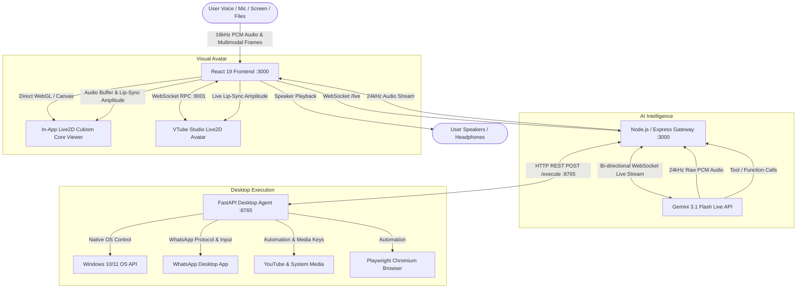

# 🌸 Akari AI — Developer Documentation

> **Next-Generation Real-Time Multimodal Voice Companion & JARVIS-Class Desktop Automation Agent**  
> Built for **Siddhant** • Powered by **Google Gemini 3.1 Flash Live**, **Live2D Cubism Core**, & **FastAPI Desktop Agent**

---

## 📑 Table of Contents
1. [Project Overview](#-project-overview)
2. [High-Level Architecture](#-high-level-architecture)
3. [Complete Technology Stack](#-complete-technology-stack)
4. [Key Features & Capabilities](#-key-features--capabilities)
5. [WhatsApp & YouTube Automation Engine](#-whatsapp--youtube-automation-engine)
6. [Real-Time Audio Pipeline & Zero Voice Break Engine](#-real-time-audio-pipeline--zero-voice-break-engine)
7. [Live2D Avatar & Lip-Sync Subsystem](#-live2d-avatar--lip-sync-subsystem)
8. [Directory & File Structure](#-directory--file-structure)
9. [Prerequisites & Environment Setup](#-prerequisites--environment-setup)
10. [Running the Application](#-running-the-application)
11. [Standalone Desktop Software Architecture (Electron)](#-standalone-desktop-software-architecture-electron)
12. [Desktop Control Tools & Function Calling API](#-desktop-control-tools--function-calling-api)
13. [PowerPoint & Presentation Automation Engine](#-powerpoint--presentation-automation-engine)
14. [Memory & Reminder Subsystems](#-memory--reminder-subsystems)
15. [User Authentication & Commercial Subscription Engine](#-user-authentication--commercial-subscription-engine)
16. [Building Single-Click Windows .exe Installer Package](#-building-single-click-windows-exe-installer-package)

---

## 🌟 Project Overview

**Akari AI** is an ultra-responsive, real-time voice and multimodal companion agent designed to perform desktop operating system tasks, answer complex technical queries, analyze live screen shares and attached files, and converse naturally with ultra-low latency voice synthesis and synchronized **Live2D lip-sync**.

```
  ┌─────────────────────────────────────────────────────────────────────────┐
  │                           AKARI AI ECOSYSTEM                            │
  ├──────────────────┬──────────────────────┬───────────────────────────────┤
  │   REACT 19 UI    │  NODE GATEWAY (TSX)  │    PYTHON DESKTOP AGENT       │
  │ • Live2D Sync    │ • Gemini Live Stream │ • 94 Windows Automation Tools │
  │ • Web Audio PCM  │ • Memory Engine      │ • Native OS Shell & Windowing │
  │ • Screen Sharing │ • Reminder Scheduler │ • Playwright Browser Engine   │
  │ • File Dropper   │ • WhatsApp / YouTube │ • Clipboard & Media Shortcuts │
  └──────────────────┴──────────────────────┴───────────────────────────────┘
```

---

## 🏛️ High-Level Architecture



---

## 💻 Complete Technology Stack

### 1. Frontend Layer
| Technology | Version | Purpose |
|---|---|---|
| **React** | `19.0.1` | Component UI framework with strict concurrency |
| **TypeScript** | `5.8.2` | End-to-end type safety |
| **Vite** | `6.2.3` | Ultra-fast build tool and development server with HMR |
| **Tailwind CSS** | `4.1.14` | Styling framework, custom glassmorphism design tokens |
| **Motion** | `12.23.24` | Fluid animations, drawer slide-ins, modal transitions |
| **Pixi.js / Live2D Cubism** | `5.3.12` / `Cubism 4` | Embedded WebGL Live2D character rendering |
| **Lucide React** | `0.546.0` | Vector UI icons |
| **PDF.js** | `3.11.174` | In-browser PDF text & page preview rendering |

### 2. Real-Time Audio Pipeline
| Component | Specification | Function |
|---|---|---|
| **AudioContext** | 16,000 Hz / 24,000 Hz | Dual sampling audio bus management |
| **ScriptProcessorNode** | Buffer: `512` samples (~32ms) | Ultra-low-latency 16-bit PCM microphone streaming |
| **AnalyserNode** | FFT Size: `256`, Smoothing: `0.3` | Real-time amplitude and frequency binning for visualizer |
| **Adaptive Jitter Buffer** | Lead time: `40ms` cushion | Seamless 24kHz Gemini Live audio chunk playback without voice breaks |
| **Auto-Reconnect Engine** | Exponential backoff (`1000ms`) | Keeps microphone active across Gemini turn completions & session refreshes |

### 3. Avatar & Live2D Animation
| Component | Integration | Description |
|---|---|---|
| **In-App Live2D Viewer** | `pixi-live2d-display` | Embedded WebGL rendering of Akari Live2D model directly in the browser |
| **VTube Studio API** | WebSocket RPC (`ws://127.0.0.1:8001`) | Optional external Live2D model parameter injection |
| **Lip-Sync Engine** | `ParamMouthOpenY`, `MouthOpen` | Dynamic audio volume modulation with phonetic syllable curve |
| **Gaze & Head Control** | Cursor tracking toggle | Toggleable mouse cursor tracking for head and eye motion |

### 4. Server & Gateway Layer
| Component | Technology | Description |
|---|---|---|
| **Runtime** | **Node.js 20+** via **TSX** | TypeScript execution without manual compilation |
| **HTTP Server** | **Express.js** `4.21.2` | REST endpoints for health, memories, reminders, YouTube search |
| **WebSocket Server** | **`ws`** `8.21.0` | Low-latency full-duplex socket server on `/live` |
| **AI SDK** | **`@google/genai`** `2.4.0` | Official Google GenAI SDK with Live API client |
| **Memory Engine** | Custom JSON Store | Asynchronous background memory extraction using LLM conversation slicing |

### 5. JARVIS Desktop Automation Agent
| Component | Library | Purpose |
|---|---|---|
| **Framework** | **FastAPI** + **Uvicorn** | HTTP ASGI server running on `http://127.0.0.1:8765` |
| **OS Windowing** | `ctypes.windll.user32` | Native foreground window activation and un-minimization |
| **Process Launcher** | `os.startfile`, `subprocess` | Direct Windows GUI process spawning |
| **WhatsApp Automation** | `pyautogui`, `pyperclip`, Protocol | Contact search, Unicode clipboard typing, and auto-dispatch |
| **Media & Audio** | `pycaw`, OS Media Keys | Master volume, YouTube media control (play, pause, skip, seek) |
| **Screen Capture** | `Pillow (PIL)` / `ImageGrab` | Multi-monitor screenshotting and active window OCR |
| **Browser Engine** | **Playwright** (Chromium) | Deep DOM automation, form filling, scraping |

---

## 📱 WhatsApp & YouTube Automation Engine

### 1. WhatsApp Automation (`whatsappSendMessage`)
* **Strict Invocation Policy**: Akari **never** opens WhatsApp on her own. She only launches or interacts with WhatsApp when explicitly commanded by the user.
* **Contact Name Search**: Brings WhatsApp to focus, triggers `Ctrl + F`, types the contact name (e.g. *"Siddhant"*, *"Mom"*), opens the chat, pastes the text accurately via clipboard (supporting emojis, Hindi, English, and symbols), and presses `Enter` to send.
* **Phone Number Support**: Automatically formats international/local phone numbers and opens the exact conversation via `whatsapp://send?phone=...&text=...`.
* **Drafting Option**: Can type text into the input field without sending if the user asks to *"just type it"*.

### 2. YouTube Automation (`youtubeControl` & `desktopBrowserOpenYoutubeVideo`)
* **Strict Invocation Policy**: YouTube is only opened when requested.
* **Top Result Video Launcher**: Searches YouTube and automatically begins playing the best matching video.
* **Playback Controls**:
  * **Play / Pause**: Toggle video playback via `k` / OS media keys.
  * **10s Skip / Rewind**: Fast-forward (`l`) or rewind (`j`).
  * **Volume Adjustment**: Set volume 0–100% via `ArrowUp`/`ArrowDown`.
  * **Mute / Unmute**: Toggle audio mute (`m`).
  * **Fullscreen**: Toggle fullscreen mode (`f`).

---

## 🔊 Real-Time Audio Pipeline & Zero Voice Break Engine

### 1. Multi-Part Packet Forwarding (`server.ts`)
Gemini Live frequently streams multi-part responses containing interleaved text and raw audio chunks across `parts[]`. The gateway iterates across **all** array elements in `message.serverContent.modelTurn.parts` so zero audio packets are lost in transit.

### 2. 40ms Adaptive Jitter Buffer (`src/lib/audio.ts`)
To eliminate network packet arrival jitter and audio crackles:
* Initial audio bursts use a **40ms adaptive lookahead cushion** (`outputAudioCtx.currentTime + 0.040`).
* Subsequent chunks in the active stream are chained with sample accuracy (`nextStartTime += buffer.duration`).
* An automatic **180ms debounce** on voice activity teardown prevents audio clipping between syllables.

### 3. Persistent Microphone Stream & Auto-Reconnect
* Microphone tracks remain continuously enabled (`track.enabled = true`) and open.
* Removed accidental global Space key listeners that previously muted the microphone track.
* If Gemini Live closes a session turn or undergoes a server refresh (`session_closed`), Akari automatically reconnects in the background (`triggerAutoReconnect`) without halting microphone capture.

---

## 🎭 Live2D Avatar & 17-Emotion Facial Subsystem

1. **Embedded WebGL Cubism Core Viewer (`AkariLive2DViewer.tsx`)**:
   * Renders the bundled Akari Live2D model (`/live2d/akari/akari.model3.json`) directly inside the canvas.
   * Natural mouth opening curve scaled to incoming audio frequency amplitude.
   * Procedural idle breathing and blinking cycles.
   * **Cursor Motion Toggle**: Option in settings to enable or disable head and eye tracking to the mouse cursor.

2. **Full 17-Emotion Live2D Rigging Matrix**:
   | Emotion | Live2D Parameters & Rigging | Trigger Triggers (Hindi + English) |
   |---|---|---|
   | **`idle`** | Neutral brows, soft breathing | Default state |
   | **`happy`** | `EyeSmile: 0.85`, `Cheek: 0.6`, `BrowY: 0.35` | *"khush", "good", "nice", "badhiya", "mast", "love"* |
   | **`excited`** | `EyeSmile: 0.95`, `Cheek: 0.75`, `BrowY: 0.5`, `EyeOpen: 1.1` | *"kamaal", "zabardast", "awesome", "hyped", "fire", "🔥"* |
   | **`curious`** | `EyeOpen: 1.15`, `BrowY: 0.4`, `BrowAngle: 0.2` | *"kya", "kyun", "kaise", "why", "how", "tell me more"* |
   | **`thinking`** | `BrowY: -0.3`, `BrowAngle: -0.3`, `EyeOpen: 0.9` | *"soch", "dekhte", "calculate", "processing", "analyzing"* |
   | **`proud`** | `EyeSmile: 0.5`, `Cheek: 0.4`, `BrowY: 0.3` | *"ho gaya", "kar diya", "expert", "perfect", "done"* |
   | **`sad`** | `BrowY: -0.5`, `BrowAngle: 0.6`, `Tears: 0.5`, `Cheek: 0.2` | *"dukh", "dard", "sorry", "sad", "problem", "broken", "😭"* |
   | **`surprised`**| `EyeOpen: 1.35`, `BrowY: 0.8`, `Shock: 0.4` | *"arre", "sach mein", "omg", "shock", "unexpected", "😲"* |
   | **`embarrassed`**| `EyeSmile: 0.45`, `Cheek: 0.95`, `BrowY: -0.2` | *"sharam", "shy", "nervous", "oops", "blush", "🙈"* |
   | **`playful`** | `EyeSmile: 0.75`, `Cheek: 0.65`, `BrowY: 0.3` | *"mazak", "haha", "lol", "joke", "funny", "hehe", "😜"* |
   | **`angry`** | `BrowAngle: -0.7`, `BrowY: -0.45`, `BrowForm: -0.7`, `EyeOpen: 0.8` | *"gussa", "mad", "angry", "chup", "bakwaas", "dimag kharab"* |
   | **`annoyed`** | `BrowAngle: -0.35`, `BrowY: -0.25`, `EyeOpen: 0.85`, `Cheek: 0.15` | *"irritated", "kya yaar", "sigh", "boring", "pak gaya", "🙄"* |
   | **`flustered`**| `EyeSmile: 0.75`, `Cheek: 1.0` (Max Blush), `HeartEye: 1.0` | *"love you", "meri jaan", "sweetheart", "darling", "cutie", "😍"* |
   | **`sleepy`** | `EyeOpen: 0.35` (Droopy lids), `BrowY: -0.15`, `Cheek: 0.2` | *"neend", "so jao", "goodnight", "tired", "shubh ratri", "😴"* |
   | **`smug`** | `EyeSmile: 0.65`, `BrowY: 0.35`, `BrowAngle: -0.3`, `BrowForm: 0.55` | *"told you", "dekh liya", "smart hu", "ez", "pro", "savage", "😏"* |
   | **`caring`** | `EyeSmile: 0.75`, `EyeOpen: 1.05`, `BrowY: 0.45`, `BrowAngle: 0.4` | *"take care", "tabiyat", "headache", "bimar", "help me", "🥺"* |
   | **`focused`** | `EyeOpen: 1.15` (Laser stare), `BrowY: -0.2`, `BrowAngle: -0.25` | *"coding", "compile", "terminal", "debug", "execute", "deploy"* |

3. **VTube Studio Integration (`vtsClient.ts`)**:
   * Connects to VTube Studio over WebSocket RPC on port `8001`.
   * Maps audio volume to `ParamMouthOpen` with continuous calibration.

---

## ⚡ Jr. Sidd — Male AI Model Archetype

**Jr. Sidd** is the male AI counterpart, digital twin, and ultimate wingman for **Siddhant**:
* **Capabilities**: Identical to Akari — full access to all 94 Windows JARVIS desktop tools, WhatsApp automation, YouTube controls, screen vision, memory, reminders, and file review.
* **Persona & Tone**: Sharp, cool, brotherly, loyal, and ultra-capable.
* **Default Male Voice**: **`Fenrir`** (bold, crisp, and confident male voice). Also supports `Charon` (deep male) and `Puck` (playful male).
* **Strict Male Hindi Grammar**: Configured with absolute system rules requiring male Hindi verb endings (`karta hu`, `karunga`, `ja raha hu`, `ho gaya bhai`, `boliye bhai`). Never uses feminine verbs.
* **Wake Word Phrases**:
  * `"Hey Jr Sidd"` / `"Wake up Jr Sidd"` / `"Jr Sidd wake up"` / `"Jr Sidd utho"` / `"Jr Sidd suno"`
  * `"Hey Sidd"` / `"Wake up Sidd"` / `"Sidd wake up"` / `"Hey Junior"` / `"Wake up Junior"`
* **Visual Representation**: Dedicated futuristic cybernetic holographic AI core with dynamic audio-reactive neon rings, HUD status badges, and pulsing audio visualizers.
* **Instant Switching**: Toggle seamlessly between **Akari**, **Jr. Sidd**, and **Aegis Core** directly in Settings > *Sys_Config* or *Audio_I/O*.

---

## 📁 Directory & File Structure

```
Akari-AI/
├── agent/                       # Python Desktop Automation Agent (FastAPI)
│   ├── backends/                # Platform OS implementations
│   │   ├── base.py              # Abstract OSBackend base classes
│   │   └── windows.py           # Windows native launcher, pycaw, user32 APIs
│   ├── tools/                   # 94 Registered automation tools
│   │   ├── applications.py      # WhatsApp, YouTube, Spotify, VS Code, Calc
│   │   ├── browser.py           # Playwright Chromium automation
│   │   ├── files.py             # File system CRUD operations
│   │   ├── os_input.py          # PyAutoGUI keyboard/mouse events
│   │   ├── pc.py                # Volume, power, brightness controls
│   │   ├── screenshot.py        # Screenshotting and OCR
│   │   ├── search.py            # YouTube & Google web search
│   │   └── websites.py          # Native Windows browser URL launcher
│   ├── registry.py              # Tool registry decorator & dispatcher
│   └── server.py                # FastAPI main server entrypoint (:8765)
├── public/                      # Static Assets & Live2D Models
│   └── live2d/                  # Akari Cubism 4 Live2D model assets
├── src/                         # React 19 Frontend Source
│   ├── components/              # UI Components
│   │   ├── AkariLive2DViewer.tsx# Embedded Live2D WebGL canvas renderer
│   │   ├── ApiKeyGate.tsx       # First-run API key setup modal
│   │   ├── BrowserAgent.tsx     # In-app browser viewer
│   │   ├── ChatPanel.tsx        # Live text chat drawer & emotion badges
│   │   ├── AkariCoreVisualizer # Audio waveform & orb visualizer
│   │   ├── MemoryDashboard.tsx  # Memory viewer & category editor
│   │   ├── SettingsPanel.tsx    # Voice, Avatar style, Wake word settings
│   │   ├── Toast.tsx            # Live visual status notifications
│   │   └── TranscriptPanel.tsx  # Live conversation captions
│   ├── lib/                     # Client Libraries
│   │   ├── audio.ts             # Web Audio PCM recorder, jitter buffer, persistent stream
│   │   ├── fileProcessor.ts     # Multimodal PDF, image, text file extractor
│   │   ├── memoryTypes.ts       # TypeScript interfaces for memories
│   │   ├── settingsStore.ts     # LocalStorage settings synchronization
│   │   ├── vtsClient.ts         # VTube Studio WebSocket RPC & lip-sync
│   │   └── wakeWord.ts          # Continuous phonetic wake word detector
│   ├── App.tsx                  # Main application orchestrator
│   ├── index.css                # Tailwind CSS v4 & custom animations
│   └── main.tsx                 # React DOM root entrypoint
├── Developer-README.md          # Comprehensive technical documentation
├── Install_Windows_AutoStart.bat# Windows startup and desktop shortcut installer
├── install_shortcuts.ps1        # PowerShell script creating Desktop & Startup shortcuts
├── launch_akari.vbs             # Silent VBScript launcher in App Mode
├── memories.json                # Long-term persistent memories for Siddhant
├── package.json                 # Node.js dependencies & scripts
├── run_agent.py                 # Python agent standalone bootstrap
├── server.ts                    # Node.js WebSocket Gateway & Express server
├── server_memory.ts             # Memory background extraction & formatting
├── server_paths.ts              # Data path & API key security manager
├── server_reminders.ts          # Scheduled reminders event loop
├── start_akari.bat             # 1-Click Windows launch script
└── vite.config.ts               # Vite bundler configuration
```

---

## 🔧 Prerequisites & Environment Setup

### 1. Requirements
* **Node.js**: `v20.0.0` or higher
* **Python**: `3.10` or higher (with project `venv`)
* **Google Gemini API Key**: Obtain from [Google AI Studio](https://aistudio.google.com/apikey)
* **VTube Studio** *(Optional)*: Free on Steam if using external Live2D models

### 2. Environment Variables (`.env`)
```env
# Google Gemini API Key
GEMINI_API_KEY="AIzaSy..."
GOOGLE_API_KEY="AIzaSy..."

# Browser Automation Mode ('managed' or 'cdp')
AKARI_BROWSER_MODE=managed

# Desktop Agent Configuration
AKARI_AGENT_HOST=127.0.0.1
AKARI_AGENT_PORT=8765
```

---

## 🚀 Running the Application

### Method 1: Standalone Native Desktop App (Recommended — No Chrome Needed!)
Launch Akari directly as a dedicated desktop software with hardware-accelerated Live2D, zero browser address bar, and native window controls:
```powershell
# Quick double-click launcher
.\Akari-Desktop.bat

# Or via npm
npm run app
```

### Method 2: Development / Browser Mode
```powershell
# Start Node.js & Vite Dev Server for browser testing
npm run dev
```
Open **`http://localhost:3000`** in Chrome/Edge.

---

## 🖥️ Standalone Desktop Software Architecture (Electron)

Akari runs as a high-performance Windows desktop application using **Electron**:
1. **Dedicated Native Window**: Runs in a frameless/styled dark container with no URL bar, no tabs, and auto-managed window states (minimize, maximize, close, always-on-top).
2. **Hardware Acceleration**: Configured with GPU rasterization and zero-copy rendering to ensure the **Live2D Cubism model** runs at a buttery-smooth 60 FPS without background throttling.
3. **Automated Process Lifecycle**: Spawns and manages the Node.js WebSocket gateway and Python automation bridge silently in the background, cleanly terminating all child processes on window exit.
4. **Instant Launchers**:
   - `Akari-Desktop.bat`: One-click interactive Windows desktop launcher.
   - `Akari-Desktop.vbs`: Silent launcher without background terminal windows.


---

## 🛠️ Desktop Control Tools & Function Calling API

Akari has 94 registered function calling tools. Key tools include:

| Tool Name | Parameters | Description |
|---|---|---|
| `whatsappSendMessage` | `{ recipient: "...", message: "...", phone?: "..." }` | Searches contact, pastes text, and sends message on WhatsApp |
| `youtubeControl` | `{ action: "play" \| "pause" \| "skip" \| "volume", value?: 80 }` | Controls YouTube video playback, volume, and navigation |
| `desktopBrowserOpenYoutubeVideo` | `{ query: "..." }` | Opens YouTube and automatically plays top matching video |
| `openApplication` | `{ name: "whatsapp" \| "vscode" \| "calc" \| "notepad" }` | Launches native desktop GUI applications |
| `closeApplication` | `{ name: "whatsapp" \| "youtube" }` | Closes running desktop applications |
| `openWebsite` | `{ name: "github" \| url: "..." }` | Opens named website or URL in default browser |
| `searchYouTube` / `searchGoogle` | `{ query: "..." }` | Searches YouTube or Google in browser |
| `volumeUp` / `volumeDown` / `setVolume` | `{ amount?: 0.1, percent?: 70 }` | Adjusts master system audio volume |
| `createFile` / `readFile` / `deleteFile` | `{ path: "...", content?: "..." }` | Safe file system operations |
| `createPresentation` | `{ topic: "...", title?: "...", subtitle?: "...", slides?: [...], theme?: "modern_dark" \| "cyber_cyan" \| "minimal_white" \| "corporate_blue" \| "sunset_gradient" \| "emerald_green", filename?: "...", save_folder?: "desktop" }` | Generates complete, styled multi-slide PowerPoint (.pptx) presentations with structured bullet points, speaker notes, and auto-opens in PowerPoint |
| `openPowerPoint` | `{ file_path?: "..." }` | Launches Microsoft PowerPoint or opens a specific presentation file |
| `readPresentation` | `{ file_path: "..." }` | Reads, extracts, and summarizes all slides and bullet points from a .pptx file |
| `addSlideToPresentation` | `{ file_path: "...", title: "...", points: [...] }` | Appends new slides to an existing PowerPoint presentation |
| `takeScreenshot` / `analyzeScreenshot` | `{ include_image?: true }` | Full-screen capture and OCR analysis |
| `setReminder` / `listReminders` | `{ text: "...", minutes: 10 }` | Spoken reminders system |
| `getWeather` / `getNews` | `{ location: "Mumbai" }` / `{ category: "tech" }` | Live weather and news headlines |

---

## 📊 PowerPoint & Presentation Automation Engine

Akari is fully equipped to create, edit, inspect, and open Microsoft PowerPoint presentations:

1. **Intelligent Presentation Generation (`createPresentation`)**:
   - Creates 16:9 widescreen presentations with custom themes (`modern_dark`, `cyber_cyan`, `minimal_white`, `corporate_blue`, `sunset_gradient`, `emerald_green`).
   - Automatically structures title slides, executive summaries, architectural pillars, comparison cards, roadmaps, and conclusions with speaker notes.
   - Saves `.pptx` directly to the user's Desktop or Documents and opens it in Microsoft PowerPoint automatically.
2. **Presentation Access & Reading (`openPowerPoint`, `readPresentation`, `addSlideToPresentation`)**:
   - Opens Microsoft PowerPoint on demand or accesses existing `.pptx` files.
   - Extracts slide text, titles, and bullet points to summarize slide decks verbally.
   - Appends new custom slides to ongoing presentations.

---

## 🧠 Memory & Reminder Subsystems

### 1. Long-Term Memory Core (`server_memory.ts`)
* Dialogue history is periodically sliced and sent to a background consolidation prompt.
* Captured entities are categorized (identity, preference, goal, project, relationship) and appended to **`memories.json`**.
* On every Live session connect, active memories are formatted into the system prompt, providing seamless contextual recall.

### 2. Proactive Reminders (`server_reminders.ts`)
* Reminders scheduled via voice are tracked in a background 30-second interval loop.
* When a timer expires, a verbal notification is broadcast to all connected WebSocket clients.

---

## 🔐 User Authentication & Commercial Subscription Engine

Akari features a full user authentication and subscription management architecture:

1. **Authentication Providers (`src/contexts/AuthContext.tsx`)**:
   - **Google Sign-In & Email/Password**: Ready for Firebase Auth or Clerk integration.
   - **Persistent User Session**: Automatic `localStorage` session cache ensuring users stay logged in across restarts.
   - **Guest / Trial Mode**: Immediate 15-minute voice trial for new users without requiring upfront credentials.

2. **Subscription Tiers & Plan Management**:
   - **Starter Free**: 15 mins daily voice + core desktop tools.
   - **Akari Pro ($15/mo)**: Unlimited real-time voice, custom avatars (Akari & Jr. Sidd), 6 emotion synchronization, PowerPoint generation, and priority latency.
   - **Creator Tier ($29/mo)**: Unlimited document extraction, priority tool dispatching, and custom persona memory slots.

---

## 📦 Building Single-Click Windows `.exe` Installer Package

To generate an installer for distribution or sharing with users:

```powershell
# Method 1: 1-Click Batch Builder (Recommended)
.\Build-Windows-Installer.bat

# Method 2: Via npm script
npm run dist:win
```

The output will be placed in the **`release/`** directory:
* **`Akari AI Setup 1.0.0.exe`**: One-click Windows NSIS installer that automatically creates desktop and start menu shortcuts.
* **`Akari AI 1.0.0.exe`**: Zero-install standalone portable executable (`npm run dist:portable`).

---

## 👥 Author & Credits

* **Developer & Master**: Siddhant
* **Project Name**: Akari AI
* **AI Model**: Google Gemini 3.1 Flash Live Preview
* **License**: Private / Proprietary
